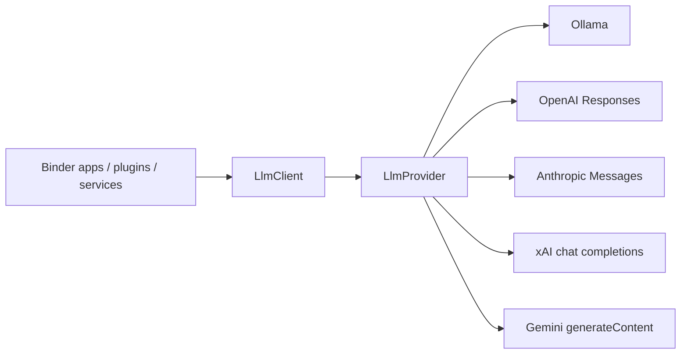

# binder-llm as-built

`binder-llm` is a Rust library. `LlmClient` is the only type applications should construct. Providers implement `LlmProvider` behind Cargo features.

Default feature: `ollama`. Cloud providers are opt-in. Configuration (`Provider`, API key, base URL, model) is the swap point — request/response types do not change.
