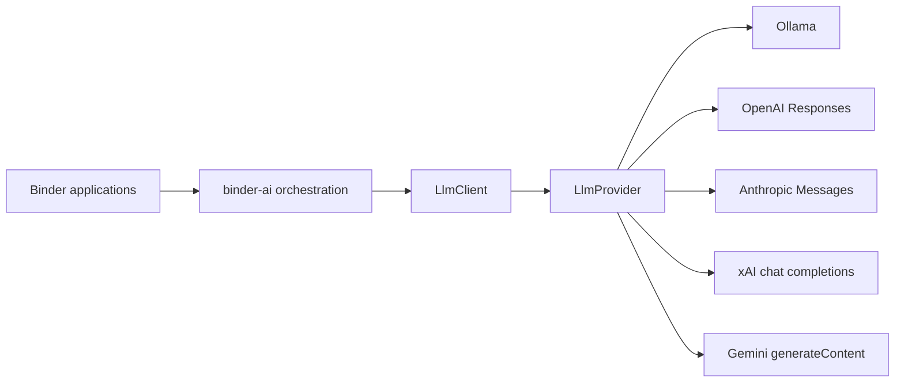

# binder-llm as-built

`binder-llm` is a Rust library. **binder-ai** constructs [`LlmClient`]. Applications do not call providers or this crate directly.

`LlmClient` is the swap point for the reasoning engine. It runs inference on supplied messages. It does not query bindb or walk repositories.

Default feature: `ollama`. Cloud providers are opt-in. Configuration (`Provider`, API key, base URL, model) is the swap point — request/response types do not change.
